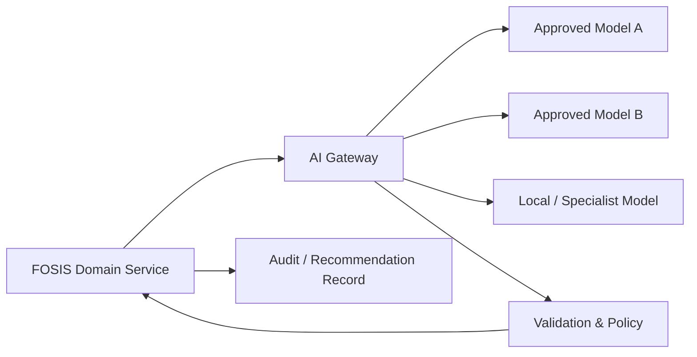

# FOSIS AI Architecture

## Principle
AI is assistive, explainable and governed. It does not silently replace required human approvals.

## AI use cases already agreed
- Recommend year/join-date options subject to policy.
- Recommend class and house allocation subject to capacity/policy.
- Generate timetable/grouping recommendations using agreed priorities.
- Support teacher/group assignment recommendations using capability, availability and experience.
- Summarise free-text change reasons into reason codes.
- Assist workflow summarisation and operational insights.

## Boundary

## Controls
- Provider abstraction: domain services do not hard-code one model vendor.
- Minimum necessary context is supplied.
- Sensitive domains such as safeguarding/medical require stricter policy and must not be exposed to models by default.
- AI output is labelled as generated/recommended and must be validated before consequential action.
- Prompt/model/version and decision metadata should be recorded where needed for auditability.
- Tenant data must not cross tenant boundaries.
