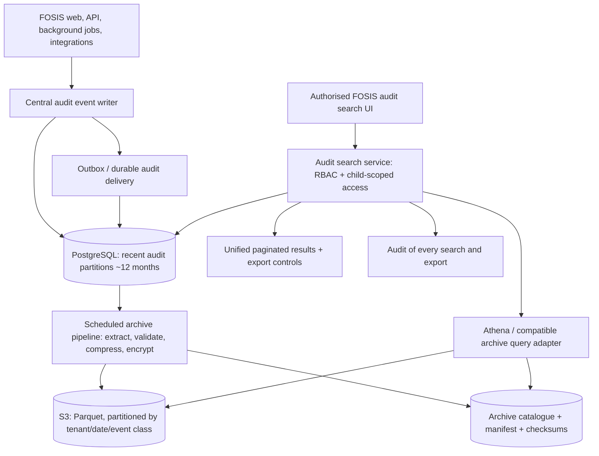

# FOSIS audit history and searchable archive architecture

Status: Approved architectural direction, 20 October 2026. Cross-reference: Epic 14 confidential access and reporting; Epic 26 retention governance. This document extends the existing FOSIS integration architecture; deployment-specific choices remain subject to engineering validation.

## Decision
Maintain complete authorised transaction change history. Keep approximately 12 months of hot audit data in PostgreSQL; archive older eligible events to encrypted, compressed, immutable object storage (initial AWS option: S3 Parquet). Provide near-time historical search through the FOSIS administration interface without manual engineering or database intervention. Ordinary searches should return in seconds where practical; exceptional large searches may be asynchronous.

## Logical architecture

## Event model
Append-only event ID; tenant ID; timestamp UTC; actor/service ID; actor role; session/correlation/request ID; entity type and opaque entity ID; operation (create/read/update/delete-attempt/export/denied access); outcome; reason/approval reference when relevant; previous/new field values for changes (minimised, encrypted or redacted as appropriate); data classification; school and child-specific authorisation context where relevant. Avoid copying sensitive narrative content into generic access logs. Not every routine public or system read needs full row-level capture; sensitive reads must be audited. Define a policy matrix per data class.

## Lifecycle
1. Write audit events reliably and idempotently, with a durable outbox/queue for failures; never silently lose required security events.
2. Partition recent PostgreSQL audit data by month (and tenant as appropriate). Use narrow indexes for common filters; keep primary transactional tables independent of audit history.
3. On a schedule, archive closed partitions older than the hot-retention threshold. Produce compressed Parquet, tenant/date/event-class partitions, a catalogue, row counts and cryptographic checksums.
4. Verify completeness, queryability, retention labels, object encryption and legal holds BEFORE detaching/purging the hot copy. Ensure recoverable retries and no gaps or duplicates.
5. Route queries by date range to PostgreSQL, archive query service, or both; merge, paginate and deduplicate results under identical permissions. Aim for near-time results; use async jobs for exceptional broad searches.
6. Enforce tenant isolation, role permission AND child-specific connection for pastoral/safeguarding data, at the query service and archive access layers. Never expose direct Athena/S3 access to school users.
7. Apply jurisdiction/category retention schedules, legal holds, deletion/anonymisation where permitted, and tamper-evident storage. Public verification and staff audit trails are separate concerns.

## Operational considerations
- S3 Standard or another immediately queryable storage class for interactive historical search. Glacier-class archives are not directly suitable for near-time queries without retrieval.
- Athena is a proposed AWS implementation, not a hard dependency; use a provider-neutral archive query interface for alternative object storage and query engines.
- Keep archive metadata/catalogue small; don't create a second full relational audit database. Query cost and latency depend on partitions, file sizes, selective predicates and query frequency.
- Monitor ingest lag, archive lag, verification failures, query latency, audit completeness, storage by tenant, object-store and query costs. Encrypt in transit and at rest, with restricted key access.
- Backups, replicas, indexes and storage overhead are not included in earlier illustrative audit-growth estimates. Benchmark realistic events and queries before setting SLAs.

## Acceptance criteria
- [ ] Every required change event preserves old/new values or a secure reference sufficient to reconstruct the history.
- [ ] Sensitive views, exports and denied access attempts are auditable; access audit is not equivalent to indiscriminate logging of all database SELECT statements.
- [ ] Historical queries across the 12-month boundary return consistent results in one UI with no technical intervention.
- [ ] A failed archive verification never triggers deletion of source records.
- [ ] Archived events remain tamper-evident, encrypted, retention-governed and tenant-isolated.
- [ ] Users without the required role AND student-specific connection cannot retrieve restricted events, including through exports.
- [ ] Search and export activity is itself audited.
- [ ] Load tests establish realistic near-time query targets and a fallback asynchronous path for oversized investigations.
