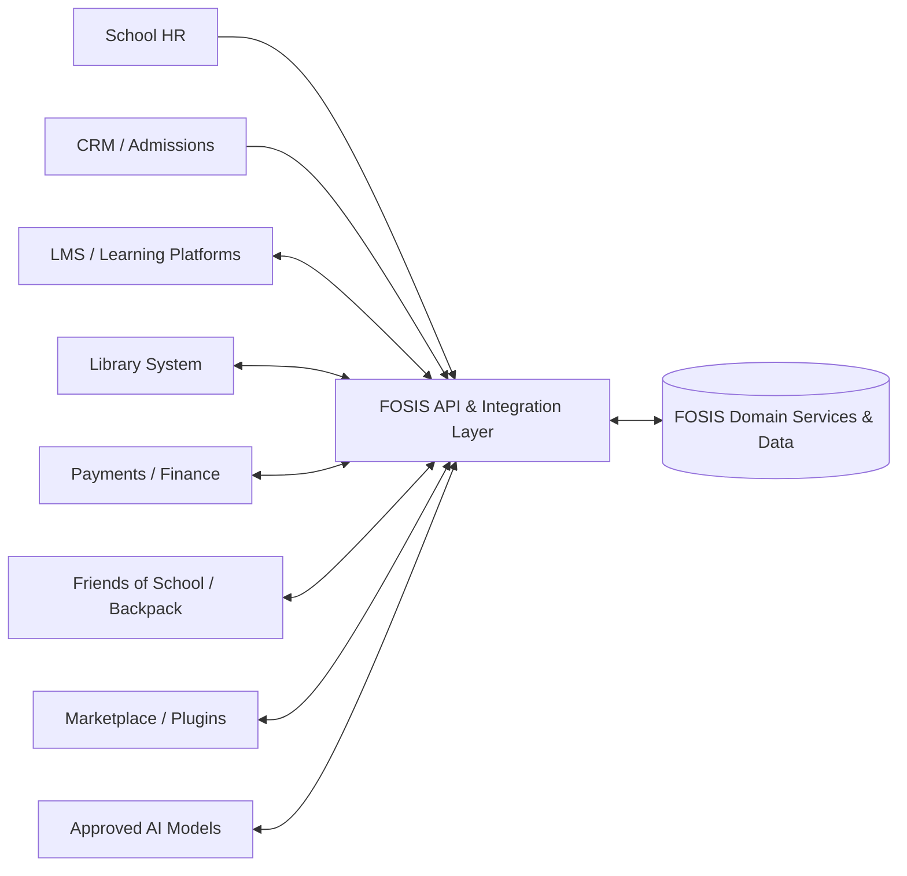

# FOSIS Integration Architecture

## Model
FOSIS is the system-of-record hub. External systems exchange data through governed APIs/events rather than direct database coupling.

## Integration patterns
- REST APIs for synchronous read/write operations.
- Events/webhooks for lifecycle changes and downstream notification.
- OneRoster 1.2 for standards-compatible roster exchange.
- Batch import for controlled onboarding/migration where required.
- External identifiers/mappings retained without making vendor IDs primary FOSIS identifiers.

## Data into FOSIS
Potential sources include school HR, CRM/admissions, learning platforms, approved library systems, finance/payment services and controlled imports. Validation, tenant context, authorisation and audit apply before persistence.

## Data out of FOSIS
Authorised consumers can receive roster, enrolment, timetable, attendance, assessment or other permitted domain data through scoped APIs/events. Data minimisation and role/tenant policy apply.

## AI
AI providers interact through a governed AI service boundary. Only necessary context is sent; outputs are treated as recommendations or generated content and are auditable where used in workflows.

## Marketplace/plugins
Plugins use explicit scopes and versioned APIs. A plugin must not receive unrestricted database access. Installation/configuration is tenant-aware and auditable.

## Friends of School
Friends of School/Backpack consumes permitted FOSIS data and receives relevant events; write-back uses authenticated APIs and FOSIS workflow/policy rules. See friends-of-school-integration.md.
