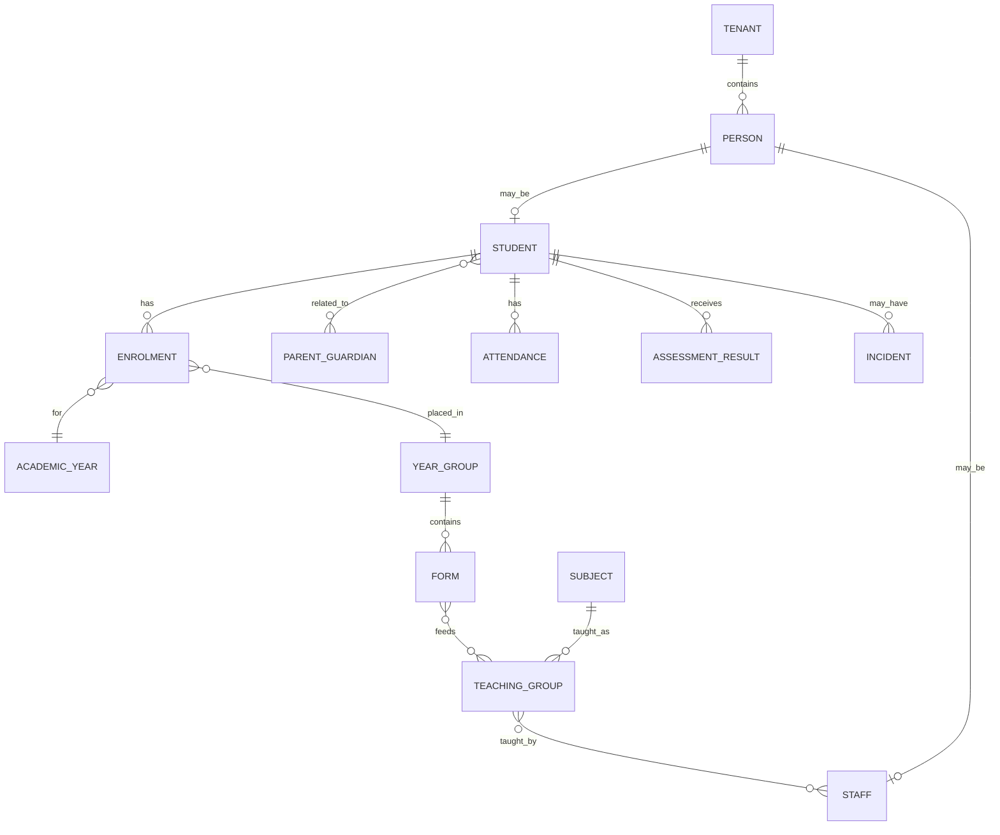

# FOSIS Logical Data Model

## Core identity and tenancy
- Tenant/School
- Person
- Student
- ParentGuardian
- Staff
- PersonRelationship
- UserAccount / RoleAssignment

Person and Student are separate concepts. A student is linked to parent/guardian records; the agreed uniqueness process requires at least one parent/guardian context when identifying a student.

## Academic structure
- Curriculum -> KeyStage -> YearGroup -> Form
- Subject
- TeachingGroup
- TeachingGroupMembership
- TeacherAssignment
- AcademicYear / Term / TeachingSession
- Room / Facility

Subjects may span year groups. Teaching groups can combine forms. Multiple teachers may serve a teaching group with a designated leader.

## Student lifecycle
- Admission/Application context
- Enrolment
- EnrolmentDocument
- EnrolmentApproval/Task
- ClassAllocation / HouseAllocation
- ElectiveSelection
- Withdrawal
- Completion
- Promotion / RepeatYearException
- Alumni/Leaver status

Enrolment is annual. Withdrawal closes an enrolment; rejoining creates a new enrolment.

## Learning and wellbeing
- Attendance / Absence / LeaveRequest
- Assessment / AssessmentResult / GradeScheme
- Report / ReportComment / Review
- Incident / PastoralRecord / SafeguardingRecord
- Reward / HousePoint
- SEND record
- MedicalRecord / Medication / EmergencyAdministration

Safeguarding and medical information require restricted access policies beyond ordinary academic access.

## Facilities and library
- Site / Building / Room / Resource
- Booking
- Maintenance-related linkage
- LibraryIntegration / ExternalLibraryIdentifier

Library is a separate epic/domain and may integrate an external open-source library system rather than duplicating full library-management capability inside FOSIS.

## Cross-cutting entities
- WorkflowTask / Approval
- Notification
- DocumentReference
- AuditEvent
- Configuration / Policy
- ExternalSystem / ExternalIdentifier
- IntegrationEvent
- AIRecommendation / AIReasonCode

## Conceptual relationships

## Implementation constraints
The implementation-level PostgreSQL/Supabase physical schema remains a separate step: PK/FK choices, indexes, RLS policies, retention and migration strategy must be validated before implementation.
