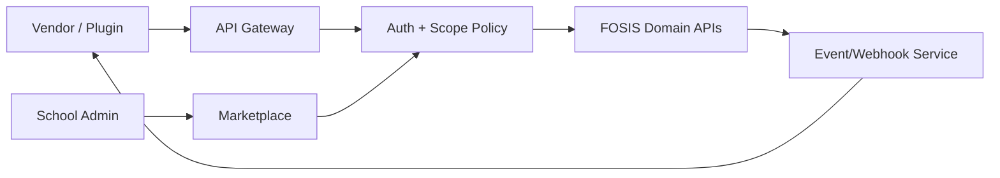

# FOSIS Marketplace and Plugin Architecture

## Purpose
Epic 33 provides a controlled ecosystem for external services without granting direct access to the FOSIS database.

## Components
- Marketplace catalogue
- Vendor/application registration
- Tenant installation/configuration
- Permission/scope grant
- API credentials/token management
- Webhook/event subscriptions
- Usage/audit records
- Disable/revoke controls

## Interaction

## Rules
- Plugins use versioned APIs and explicit scopes.
- Tenant administrator controls installation and granted capabilities.
- Direct database access is prohibited.
- Every call is tenant-scoped, authenticated and auditable.
- Plugins receive only data required for their approved function.
- Revocation must stop future access without corrupting FOSIS system-of-record data.
- Vendor-specific objects use external identifiers/mappings.
