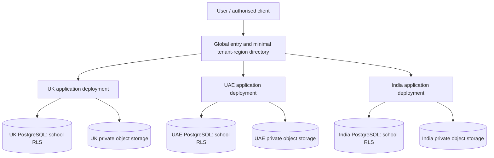

# FOSIS regional tenancy and deployment architecture

**Status:** Approved platform architectural direction — 21 October 2026. **Scope:** FOSIS SIS across UK, UAE and India. Implementation and legal/residency validation pending.

## Approved decision
- Maintain **one FOSIS application codebase and one CI/CD pipeline**, deploying the same versioned artefact into **separate UK, UAE and India application environments**. Regional releases may be progressively promoted or rolled back independently.
- Operate **one regional PostgreSQL database per market/environment**, shared by that region's schools. Use mandatory school `tenant_id` scoping, PostgreSQL **row-level security (RLS)**, composite tenant-aware keys/foreign keys, least-privilege database roles and automated isolation tests.
- Keep student documents in **private regional object storage**, with school-specific namespaces/prefixes and server-side authorisation. Prefixes are organisational, **not** security boundaries by themselves. Dedicated buckets/databases remain an optional future tier, not the baseline.
- Use a **minimal global tenant-to-region routing directory** (school/tenant identifier, home region, routing metadata only); do not replicate student or sensitive school records into this directory.
- Regionalise application credentials, storage, backups, audit data, encryption configuration, job processing and disaster recovery; assess analytics, AI processing, messaging, observability, support access and third-party subprocessors for regional data flows.
- Provide schools transparent assurance of **logical tenant isolation**, not a claim of physically separate per-school databases or of zero commingling. Regional shared databases contain multiple schools' records.
- Keep an explicit tenant-authorisation boundary for multi-school guardians/staff; global identity never implies cross-school data access.

## Reference flow

## Required controls and acceptance criteria
1. Verify authenticated school context at ingress; never trust a client-supplied `tenant_id`. Scope every request, job, import, export and event to the verified tenant.
2. Apply RLS to every tenant-owned table, including join/association tables; use `FORCE ROW LEVEL SECURITY` where applicable. Ordinary runtime DB credentials must not own tables or have `BYPASSRLS`/superuser privileges. Review security-definer functions and pooled-connection tenant-context leakage.
3. Enforce tenant-aware referential integrity and deny cross-tenant read, write, export, search, analytics and object download; test both allowed and denied access in CI, including admin/service and background jobs.
4. For object storage, use private buckets, short-lived authorised access or mediated downloads, non-guessable object keys, least-privilege regional identities, malware scanning, encryption and complete sensitive-access/export audit.
5. Keep backups, logs, archived audits, document derivatives, caches and AI/third-party processing within the approved regional boundary unless a documented lawful exception is approved.
6. Maintain regional infrastructure as code and one pipeline with region-specific configuration and secrets; release progressively with regional health checks, migration compatibility, rollback and disaster-recovery tests.
7. Record any authorised privileged support access, emergency exceptions, and inter-school student transfers with explicit legal/role checks and audit trails. Cross-school transfers are not automatic.
8. Validate jurisdiction-specific data-protection, education and health requirements before claiming regional residency compliance; regional database location alone is insufficient.

## Relationship to existing architecture
This is an **approved refinement of ADR-004** in `docs/fosis-blueprint/01-solution-architecture.md`: shared PostgreSQL means **shared within a region**, not a single worldwide database. It also specifies the previously unresolved deployment topology. The broader blueprint remains a proposed implementation baseline. Epic 18 student documents use this regional storage model; Epic 26 governs retention and disposal.

## Open engineering implementation choices
Cloud provider and exact region availability, PostgreSQL hosting model, object-store bucket-per-region versus multiple private buckets, key management, global routing implementation, backup topology, DR objectives, dedicated-tenant migration path, and independently validated security/compliance evidence.
