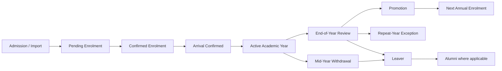

# FOSIS Student Lifecycle

## Agreed rules
- Pending enrolment becomes confirmed after required fees/T&C/documents.
- Large-school approval flows use two-person approval where configured; small-school roles may be combined. The current default threshold is five teaching staff and is configurable where applicable.
- Default enrolment SLA is 90 days, with reminders at 7/30 days; retries are limited to three. The timer runs only while parent action is pending.
- There is no terminal Rejected state for ordinary information gaps: use Pending/More Information.
- Reception confirms arrival. Non-arrival alerts administrators first; late arrival remains possible.
- Withdrawal can be parent- or school-initiated. Disciplinary withdrawal requires higher authority and evidence.
- End-of-year completion is recommended by FOSIS and confirmed by admin; auto-completion may occur after a configurable year-end grace period.
- Promotion is prepared approximately two weeks before term or on admin action and requires admin approval/change.
- Non-completion and repeat year use exception workflows with parent approval where agreed.
- Rejoining after withdrawal creates a new enrolment rather than reopening the closed enrolment.
