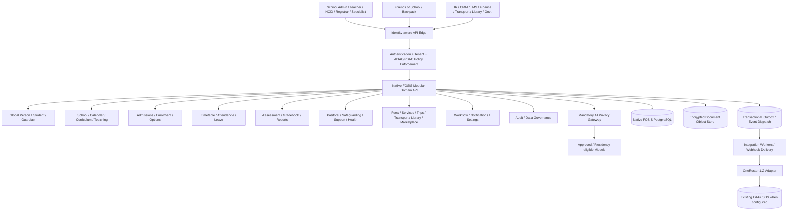

# FOSIS — Whole-Platform Solution Architecture (Draft v1.0)
**Status:** Proposed implementation baseline, not an approved Architecture Decision Record (ADR). **Scope:** Epics 1–41 and Platform Configuration Management (#249). **Repository assessed:** `aqualeo/fosis`, October 2026.

## A1. Authority and sources
The decisions in [the existing architecture index](../architecture/README.md), [enterprise architecture](../architecture/enterprise-architecture.md), [integration](../architecture/integration-architecture.md), [security](../architecture/security-rbac-architecture.md), [AI](../architecture/ai-architecture.md), [lifecycle](../architecture/student-lifecycle.md) and corresponding GitHub epic/story issues are the product baseline. This document extends rather than supersedes them. Detailed behaviour follows an approved issue; where issues disagree, stop the implementation slice and raise an ADR. Technical selections below are **proposals**, not previously agreed product decisions.

**Repository reality:** Root `package.json` and `README.md` describe a Node.js/Express Ed-Fi ODS → OneRoster 1.2 service (PostgreSQL or MSSQL using Knex). This is an *existing integration component*, **not a completed FOSIS SIS backend**. Its Ed-Fi ODS remains authoritative **for that adapter**, not by implication for future native FOSIS records. Preserve its compatibility and tests. Decide whether to place native SIS modules in this repo (separate `apps/fosis-api`) or another repo before implementation.

## A2. Purpose, boundaries and architectural principles
- One AI-assisted, privacy-first, API-first school information system for nursery through Year 13, multiple curricula, campuses, terms, jurisdictions and school sizes.
- FOSIS owns authoritative educational/person/enrolment records, assessment evidence, approval state and audit. Friends of School/Backpack owns its own community-facing presentation and messaging; use APIs/events, not a shared database.
- A Person can be a guardian and/or staff member, and one global FOS Person identity can relate to children at multiple schools. A Student identity, enrolment and school relationship are distinct. A global identity must never grant cross-tenant record access by itself.
- The operating rule is **AI proposes; deterministic domain rules validate; authorised people decide** where a human decision is required. No AI-only consequential write.
- Security, safeguarding, medical records, least privilege, data minimisation, regional residency and verifiable human oversight are baseline constraints, not optional tenant features.
- Existing data and published academic records are not silently overwritten by changed settings, curriculum, AI models or imports.
- Use effective-dated, versioned academic/calendar/curriculum/configuration facts and explicit lineage/provenance.
- Prefer interfaces and adapters over reconstructing external libraries, transport, payments, HR and LMS.

## A3. Architecture decision register
| ID | Decision | Classification | Status |
|---|---|---|---|
| ADR-001 | Begin native FOSIS as a **modular monolith** with domain modules, asynchronous outbox/event consumers; extract microservices if justified | Engineering recommendation | **Approval required** |
| ADR-002 | Node.js 22+ with TypeScript for new API modules; PostgreSQL as native relational store; migration tooling and runtime to be selected after repository fit assessment | Engineering recommendation | **Approval required** |
| ADR-003 | Separate native FOSIS data from Ed-Fi ODS/OneRoster projection; use adapter mapping, not direct Ed-Fi tables in new domain writes | Boundary recommendation based on existing code | **Approval required** |
| ADR-004 | Shared PostgreSQL deployment with tenant-scoped rows, composite FKs and enforced RLS; platform-level identity in controlled global schema | Proposed physical tenancy strategy | **Approval required; isolation test required** |
| ADR-005 | Event outbox/inbox, idempotent consumers and eventual consistency for integrations; ACID for same-module authoritative transitions | Proposed | **Approval required** |
| ADR-006 | Precise moment of Student ID creation: issue #82/#83 says **on confirmed physical arrival**, while Epic 1 #33 describes creation at student identity creation | **Conflicting approved story text** | **Must reconcile before Student creation/join activation** |
| ADR-007 | Global FOS Person ID, tenant-specific relationships/permissions and zero cross-school discovery | Product agreement (#45, #48, #25) | Agreed; implement with threat modelling |
| ADR-008 | Separate school-level settings UI (Epic 31) and platform-level approved defaults/locks (#249) | Product agreement | Agreed; #249 needs formal epic number |
| ADR-009 | OneRoster 1.2 is an interoperability contract, not the native canonical schema | Existing baseline architecture | Agreed in principle; mapping needs design |
| ADR-010 | Default retention seven years is **policy configurable** and subject to jurisdiction/record class, no universal automatic deletion | Epic 26 agreement | Requires per-country legal verification |
| ADR-011 | Initial hosting region, IaC, identity provider, UI framework, object storage, queues, secrets and monitoring vendors | Engineering choices | TBD; validate UAE/India/UK residency and costs |

## A4. Container / component view

The diagram depicts ownership and candidate logical deployment units, **not currently deployed services**. The existing OneRoster adapter is an Ed-Fi ODS reader; native FOSIS-to-OneRoster projections would be a separate future adapter/mapping effort unless an approved Ed-Fi synchronisation strategy is chosen.

## A5. Application/module contracts
Module boundaries are enforced by package APIs. One domain does not mutate another domain's database tables or bypass its validation; use synchronous commands for immediate invariants and outbox events for secondary effects. Domains emit immutable fact events (e.g. `EnrolmentActivated.v1`) with tenant, correlation, causation, event ID, occurrence time and schema version; PII must be minimised.

- Identity & Student Master (1): global Person/FOS IDs, student records, controlled matching/merging, no cross-school discovery.
- Guardian & Household (2): relationship and **independent** parental responsibility/access privileges, emergency contacts.
- Admissions (3) + Enrolment Lifecycle (5): applicant, offer, waitlist, requirements, annual enrolment, arrival, withdrawal, promotion. Ownership split: admissions governs offer; enrolment governs academic relationship. Exception in ADR-006.
- Academic Structure (4) + Curriculum/Groups (6) + Options (7): calendars and school organisation, subjects and objective definitions, selection/allocation. Timetabling consumes **confirmed** teaching demand/choices.
- Timetabling (8): versioned drafts, conflicts, HOD and principal approvals, separate effective publication by audience, short-term overlays not rewriting base.
- Attendance (9) + Leave (10): attendance is factual; leave is human authorisation. Approved leave prefills *draft* registers; submitted records cannot be silently rewritten.
- Assessment (11) + Gradebook (12): curriculum templates, objective evidence, teacher-controlled mark entry, moderation, configured approvals and scheduled release. Preserve raw result vs calculated/display grade. US 11.5 (#247) and 11.6 (#248) must be reconciled with Epic 12 before implementing mark entry twice.
- Reports/Reporting (13, 27): reports only from approved, visibility-filtered evidence; separate operational BI and regulatory extracts.
- Wellbeing (14–18): distinct security domains for behaviour, pastoral, safeguarding, learning support, medical and student documents. Field/object-level policy and audit on **reads**.
- Staff/Facilities (19, 20): operational staff data and bookable resources; external HR is source for employment/payroll where integrated.
- Communication (21) + Self-Service (22): delivery-policy events into Backpack and alternative school-configured channels; not a second parent portal by default.
- Import (23) and Integrations/API (24): dry run, reversible imports as permitted, scoped APIs, webhooks, versioning, rate limits and provider mapping.
- Identity & RBAC (25), Audit & Compliance (26), AI (28–29), Workflow (30), School Configuration (31), Reliability (32), Platform Configuration (#249): *cross-cutting platform modules* required before broad vertical feature exposure.
- Marketplace (33) / Fees (34) / On-Site Services (35) / Transport (36) / Trips (37) / Resources (38) / Portfolio (39) / Library (40) / CPD (41): operate through domain contracts. Regular transport provider retains route/GPS/boarding operations; library integration is preferred over full circulation reimplementation; digital resources may remain external.

## A6. API, events and integration
- Public APIs: `/api/v1/{module}`; OpenAPI contracts; request and response schemas; schema-versioned and deprecated deliberately, idempotency keys for commands.
- Authentication: OIDC or federated SAML/OIDC for staff, scoped OAuth2 client credentials for machine integrations, guardian account identity linked only after verification. Require MFA for privileged roles and step-up for sensitive actions (Epic 25).
- Authorisation: deny by default. Enforce `tenant_id + actor + role + action + resource relationship + sensitivity + effective time` at gateway, service and DB. Never trust `tenant_id` supplied in a URL/body without bound claims and policy.
- OneRoster 1.2 export contract covers supported rostering entities and scoped users; demographics, medical, safeguarding and guardian data require a specifically approved mapping and minimum-necessary disclosure.
- Import adapters: CSV/Excel, OneRoster, school CRM/admissions, HR, LMS and finance; reject/quarantine invalid records, reconciliation, replay and drift alerts.
- FoS integration: only first-name/minimal student data on the FoS side as agreed, using approved FOS ID mapping and scoped pseudonymous references where practicable. FoS writes are workflow requests, not blind database updates.
- External plugins: explicit tenant consent, reviewed scopes, vendor versions, revocation, no DB access, webhook signatures/retries/dead letters. Marketplace onboarding never weakens core policies.

## A7. Configuration + workflow architecture
The platform-owned configuration registry (#249) declares key, value type, owning epic, default, validation schema, scope, lock status, effective date and version. Epic 31 presents inherited, overridden and locked values in unified School Settings; each functional epic provides semantics and admissible ranges. Changes require diff/impact preview when meaningful; no retroactive academic rewrite.

Workflow engine (Epic 30) handles draft, approval, return, delegation, SLAs, holiday/calendar pauses, notification and audit with separation-of-duties. Domain services remain authoritative for eligibility/state transitions. Version workflow definitions; in-flight transactions keep their applicable definition unless explicitly migrated.

## A8. AI architecture and safety
Every AI call passes through Epic 29 gateway: actor authorisation, tenant policy, minimum context, PII redaction/tokenisation, regional/provider/model eligibility, prompt and output controls, safe logging. The central approved model catalogue (#249) governs use; school may enable/disable approved models by task. No generative model directly executes a domain write or bypasses approval. Score/recommendations require provenance and review. Core FOSIS works when the AI provider is unavailable. For marking: if answer cannot be read, return **Cannot Mark — Teacher Review Required**, never guessed text or zero; if readable but judgement low-confidence, display visible confidence and teacher decision (#248).

## A9. Data, security, privacy, resilience
- Native system-of-record data in relational ACID store; encrypted object storage for sensitive evidence with metadata in DB; no free-form school-sensitive material in unprotected logs.
- Separate global identity and tenant data; encrypt in transit and at rest; least-privilege service principals; secrets in managed store; backup encryption and restore testing.
- Tenant isolation tested with two schools, overlapping identifiers, parent with children in two schools, staff cross-school roles and malicious scope claims. Composite tenant FKs and PostgreSQL RLS only if ADR-004 approved. Separate platform-only access path must be strongly governed and audited.
- Append-only/tamper-evident audit event stream for authoritative changes and sensitive reads, including actor, purpose, reason, before/after redacted as appropriate. Legal holds and retention are class/jurisdiction aware; do not delete safeguarding or school records solely on generic seven-year default.
- Outbox for exactly-once *effects via idempotent processing* (at-least-once delivery); retries, poison-message quarantine, compensating workflows and reconciliation.
- Operational SLOs, backup restore objectives, response/performance budgets, security incident handling and log retention **TBD** under Epic 32. Design no hard-coded uptime/RPO/RTO promises.
- Deploy only to legally approved residency region(s); evaluate UAE/India/UK school data isolation, localisation and subcontractors before live PII.

## A10. Observability and quality gates
Structured logs/correlation IDs, metrics by endpoint and tenant without leaking PII, traces of critical distributed operations, error budgets and privileged audit reviews. CI gates: schema migration tests, policy tests, two-tenant negative tests, concurrency/state-machine tests, OpenAPI compatibility, event contract tests, accessibility, security scans, backups/restores and incident drills. No production credentials or real student data in development/tests.

## A11. Deployment reference (proposal)
`apps/fosis-api` or a separately approved native SIS repository; `packages/domain-*`; `packages/contracts`; `packages/policy`; `packages/config`; `workers/integrations`; `docs/fosis-blueprint`. Retain the existing Ed-Fi OneRoster service untouched while an explicit integration ADR is pending. Use environments local → development → staging → pilot → production, with reviewed migrations/feature flags/rollback. The deployment/cloud vendor remains TBD; do not assume AWS credits dictate permanent architecture.

## A12. Build entry gate
Before starting **each** story: confirm issue is current, story has explicit acceptance criteria, rights/data impact is reviewed, field ownership and API/event contracts exist, required ADRs are approved, dependency schemas are migration-ready, and relevant negative tests are defined. Build prompts in [05-build-prompts/](05-build-prompts/) are bounded slices, not authorisation to fill missing business rules. See [02-domain-design.md](02-domain-design.md), [03-data-model.md](03-data-model.md), and [04-development-plan.md](04-development-plan.md).
