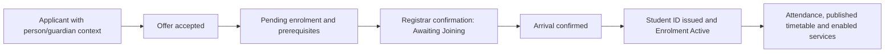
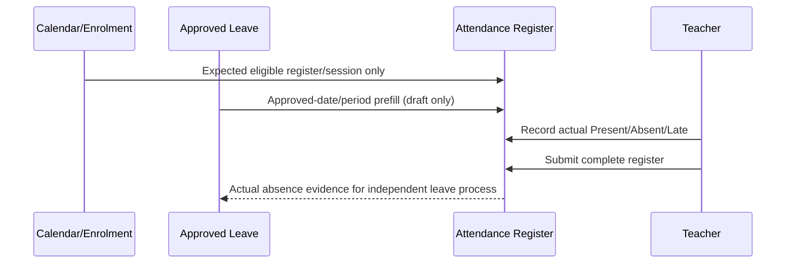

# FOSIS — Detailed Domain and Application Design (Draft v1.0)
**Status:** Design blueprint derived from GitHub issues; specific implementations remain subject to the issue acceptance criteria and ADR gates. **Companion:** [Architecture](01-solution-architecture.md) · [Data model](03-data-model.md) · [Development plan](04-development-plan.md).

## D1. Design grammar
Each domain specifies: aggregate/root, commands, state machine, policy, authorised roles/scopes, published facts, outward interface, invariant checks and audit requirements. A client UI may not become the source of authority. Each tenant-visible query MUST filter via resolved authenticated tenant + relationship/permission scopes, and each command MUST revalidate server-side. Eventual integrations cannot determine whether a same-transaction business invariant holds.

UI shared patterns: school/child context selector; summary/list/search scoped by RBAC; detail panel; reasoned actions; validated drafts; visible change preview; role-aware approval queue; audit history; configuration/default source and effective dates; accessibility/mobile keyboard navigation. Show a redacted or not-authorised screen rather than a hidden data leak. Sensitive-record screens should audit reads. In dev, use synthetic data.

## D2. Domain register, ownership and interface contracts
| Epic | Owner / core aggregate | Key command or event | UI and enforcement requirement |
|---|---|---|---|
| 1 Student Master | Identity: Student, StudentIdentifier, MergeCase | CreateIdentity, RequestStudentChange, MergeIdentity | Legal vs preferred names, unique immutable FOS ID, guardian presence and audited reversible merge (#33–44) |
| 2 Guardian | Person, StudentGuardianRelationship, Household, ContactRule | VerifyGuardian, LinkGuardian, ChangeContact | Global FOS Person ID separate from tenant access; relationship is NOT permission (#45–55) |
| 3 Admissions | Application, Offer, Waitlist, AdmissionDecision | SubmitApplication, ApproveOffer, AcceptOffer | Status history, prerequisites, controlled waitlist/offers (#56–63) |
| 4 Academic Structure | Campus, Calendar, YearGroup, Form, House | PublishCalendar, ChangeForm | Multiple calendars, teaching vs non-teaching days, effective versioning (#65–77) |
| 5 Enrolment | AnnualEnrolment, Placement, Transition | ConfirmEnrolment, RecordArrival, Withdraw, Promote | Pre-join pending/confirmed, arrival activation, academic-year history (#78–88); identity conflict ADR-006 |
| 6 Curriculum | CurriculumVersion, Subject, LearningObjective, TeachingGroup, RequiredTime | PublishCurriculum, ApproveTeachingDemand | Core/optional/elective distinct, source-provenance and subject-time rule (#109); further stories required |
| 7 Options | OptionWindow, Preference, Allocation | SubmitPreferences, ApproveAllocation | Eligibility, capacity and prerequisite previews; full story criteria pending |
| 8 Timetabling | TimetableVersion, LessonSlot, CoverOverlay | DraftTimetable, ApproveSubject, Finalise, Publish | Draft may contain clashes, final may not; HOD reviews, principal final, phased audience dates (#96,#103,#106–113) |
| 9 Attendance | Register, RegisterEntry, AttendanceAmendment | OpenRegister, SaveDraft, SubmitRegister, CorrectEntry | Never infer absent from Not marked; calendar and enrollment eligibility; business-day window (#98,#238–239,#99) |
| 10 Leave | LeaveRequest, AbsenceCase, LeaveDecision | SubmitLeave, RequestEvidence, DecideLeave | Human-authorised decision, pauseable SLAs, approval-to-draft-prefill (#100–101,#240–246) |
| 11 Assessment | AssessmentCycle, AssessmentComponent, ObjectiveAttainment | ConfirmScheme, RecommendAttainment, Moderate | Curriculum templates/versions, source change notices, teacher override and HOD moderation (#114–117,#247–248) |
| 12 Gradebook | ResultEntry, GradeVersion, ReleaseSchedule | SubmitMarks, ReviewMarks, PublishGrade | Raw marks distinct, missing not zero, school-configured review; reconcile overlap with US 11.5 |
| 13 Reports | ReportTemplate, ReportInstance, Approval | GenerateDraftReport, ApproveReport, PublishReport | Approved data only, audience controls, PDF and retrieval |
| 14 Behaviour/Pastoral | BehaviourIncident, Reward, RestrictedPastoralCase | RecordIncident, IssueReward, EscalateCase | Pastoral sensitivity segregated from ordinary behaviour; restricted access |
| 15 Safeguarding | SafeguardingConcern, Chronology, Referral, AccessGrant | LogConcern, ReferCase, EmergencyAccess | Separate security domain; sensitive-read audit and break-glass |
| 16 Learning Support | SupportNeed, Plan, Accommodation | ApproveSupportPlan, ReviewPlan | Jurisdiction-neutral core; school terminology (SEND etc.) |
| 17 Health | MedicalDeclaration, HealthAlert, MedicationAdministration | UpdateHealth, RecordAdministration | Need-to-know alerts vs restricted clinical detail; consent and emergency parent contact |
| 18 Documents | Document, Version, EvidenceRequirement | UploadEvidence, VerifyDocument, ExportPackage | Classified objects, expiry, retention, lineage, access policies |
| 19 Staff | Worker, RoleEngagement, Assignment | SynchroniseStaff, AssignTeacher, EndEngagement | Worker may be nonemployee; HR/payroll remains external |
| 20 Facilities | Site, Building, BookableSpace, ResourceBooking | ReserveSpace, ChangeCapacity | Shared/specialist equipment and no double-booking at finalisation |
| 21 Notifications | DeliveryPolicy, Template, Notification, Attempt | EnqueueNotification, RecordDelivery | Configured FoS and other channels; consent and fallback; no unauthorised data |
| 22 Self-Service | Parent/Student ActionRequest | RequestCorrection, SubmitConsent, ViewReleasedReport | Backpack default channel; age-based access, student >=14 default subject to school override |
| 23 Migration | ImportJob, Mapping, StagedRow, Reconciliation | ValidateBatch, PreviewImport, CommitBatch | Dry-run, tenant checks, audit and safe rollback where possible |
| 24 Integrations | IntegrationClient, ScopeGrant, WebhookSubscription | IssueCredentials, RevokeScope, DeliverWebhook | API versioning, OneRoster 1.2, signed events and rate limits |
| 25 IAM/RBAC | Account, Role, Grant, Policy, Delegation | EvaluatePolicy, GrantRole, RevokeRole | MFA, step-up, separation of duties, scoped and time-bound authority |
| 26 Governance | AuditEvent, RetentionRule, Consent, LegalHold | RecordAudit, ApplyHold, AssessErase | Tamper-evidence and sensitive-read audit, jurisdiction constraints |
| 27 BI/Regulatory | ReportDefinition, ExportJob, AnalyticsProjection | ScheduleReport, ExportApprovedData | Permission-filtered aggregates, no unsafe detail drill-down |
| 28 AI Layer | AIRequest, Proposal, Evaluation | Recommend, Explain, SubmitForApproval | AI has no direct authoritative write; deterministic validation, fallback |
| 29 Privacy Gateway | AIContextPolicy, TokenMap, GatewayAudit | FilterContext, RouteApprovedModel | Every AI request traverses privacy and residency gateway |
| 30 Workflow | DefinitionVersion, WorkflowInstance, Task, Decision | StartWorkflow, ApproveTask, Escalate | Versioned templates, SLAs/calendar pauses, no unauthorised self-approval |
| 31 School Configuration | SchoolOverride, EffectiveSetting, ChangeCase | PreviewSetting, ApplyAllowedSetting | One School Settings UI, by functional epic, platform lock enforcement |
| 32 Reliability | HealthSignal, Incident, CapacitySnapshot | AlertOps, RestoreService | Peak registration and rollover, recoverability and measurable SLOs |
| 33 Marketplace | Vendor, Listing, Entitlement, ScopeGrant | ApproveListing, ActivateEntitlement, Revoke | Approval, permissions, subscriptions and revenue ledger |
| 34 Fees | FeePlan, Charge, Adjustment, PaymentLink | AssessFeeImpact, ApproveConcession | Authoritative fee model, payment/ledger bridge, not embedded in enrollment |
| 35 On-site Services | ServiceCatalogue, Order, Entitlement | PlaceMealOrShopOrder | Allergen/access rules; provider/school service ownership |
| 36 Transport | ProviderLink, ExternalEntitlement, ProviderStatus | ReceiveProviderStatus | *External operator source of truth*, no FOSIS GPS/routing/boarding |
| 37 Trips/Fixtures | Activity, Participant, Consent, Incident | ApproveTrip, VerifyConsent | Need-to-know alerts, trip lead, blanket vs activity consent |
| 38 Learning Materials | MaterialCatalogue, MaterialAssignment, Loan | AssignMaterial, RecordReturn | Digital assets hosted externally as needed |
| 39 Portfolio | Achievement, Evidence, Verification, Award | SubmitAchievement, VerifyAward, RevokeAward | Longitudinal record, QR verification privacy, FoS consumes approved |
| 40 Library | LibraryProviderLink, LibraryMemberMap | ProvisionLibraryIdentity, ReadStatus | Prefer suitable OSS integration; circulation external |
| 41 Staff CPD | TrainingRequirement, CPDRecord, Verification | UploadCPDEvidence, VerifyTraining | Role-mandatory training, expiry, notifications |
| #249 Platform Settings | GlobalSetting, ModelApproval, PlatformLock | PublishGlobalSetting, ApproveModel | Platform-owned defaults and lock governance; epic number pending |

This table is a **whole-product architectural design catalogue**, not evidence that all epic-level acceptance criteria are finished. Refer to GitHub issues for exact approved business rules. No new state transition is authorised solely by this catalogue.

## D3. Cross-cutting technical interfaces
1. **RequestContext** = authenticated principal ID, resolved tenant ID, privilege grants, relationship scope, region/jurisdiction, MFA assurance, correlation ID. A tenantless global platform operation must have a distinct audited platform principal and explicit scope.
2. **CommandHandler** validates schema, tenancy, current aggregate version (optimistic concurrency), policy, workflow stage and dependencies, then persists domain state + audit + outbox in one transaction; returns result + correlation/version.
3. **QueryHandler** resolves current actor scope, joins only allowed tenant records and redacts fields by sensitivity. Cache keys include tenant and permission scope; never cache privileged data under tenant-only keys.
4. **DomainEvent** includes immutable ID, type, version, tenant, aggregate ID, aggregate version, occurred time, actor/correlation/causation IDs, minimal body. Handle duplicates/reordering and durable delivery.
5. **ConfigurationEvaluator** resolves `platform_locked > school_override_when_allowed > platform_default`, with effective date + version recorded on consequential transactions. Jurisdictional mandatory constraints override any school preference.
6. **WorkflowService** returns decisions only after policy validation and separation of duties; domain modules independently check authoritative decision ID.
7. **AIProposalService** returns suggested action/result, evidence, model/version and confidence, never commits the result directly. PrivacyGateway is mandatory, no direct provider SDK from domain modules.
8. **DocumentService** stores immutable object versions and sensitivity/access metadata; signed temporary download URLs only after every request is authorised.

## D4. Critical process design and validation scenarios

### D4.1 Identity → admission → joining → enrollment

This reflects the **specific later decision** in #82/#83, pending ADR-006 reconciliation with Epic 1 #33. Implement up through `Awaiting Joining` only until reconciled. Enrolment ID must exist before joining; a withdrawn-before-arrival enrolment preserves history. Atomic service activation: student/enrolment identity and core eligibility must commit together; secondary notifications/other services use outbox with visible pending/error and retry—not an unsupported distributed ACID transaction.

### D4.2 Guardian access
A Person ID never implies guardian access. `GuardianRelationship` stores student/tenant, verified role, parental responsibility/restriction, start/end, source and approval. Policy checks specific requested child + field/action + effective verified relationship; disallow metadata or sibling inference across tenants. Allow same guardian to use multiple schools only after separate explicit linkage.

### D4.3 Calendar, curriculum and timetabling
Calendar version applies by campus/programme/year/cohort, not one calendar per school (#65). Curriculum version, subject category, objective, teaching requirement, teaching group, allocation and option decision remain distinct. Teaching hours/periods (#109) show provenance, default mandatory-hours tolerance ±10% but do not fabricate hours. Timetable generator may draft with conflicts; final save/publish requires no hard clashes, demand compliance/exceptions, scoped HOD approval, Head-of-School final authority and separate audience-specific publication dates. Temporary adjustments ≤30 days with autoexpiry and no permanent-base overwrite.

### D4.4 Attendance and leave

No attendance obligation during holiday or before activation/after withdrawal. Unapproved leave never becomes authorised prefill. Not marked is not Absent. Submitted registers are never silently rewritten by leave changes. One-business-day correction agreed (Friday → Monday example); exact cutoff, post-window authority and partial-day overlap remain open; don't implement them from guessed defaults.

### D4.5 Assessment, gradebook and results
Assessment scheme/template → generated expected assessments → collection of raw evidence and marks → teacher draft review → configured HOD/principal moderation/approval → scheduled release/reporting. Learning-objective attainment is recommended, teacher-approved and sampled by HOD. Latest evidence default 50% weighting for attainment *recommendations only*, configurable by school; evidence exclusion requires HOD permission. All AI marks remain suggestions with review and **Cannot Mark** fallback. Resolve ownership overlap: #247 US 11.5 records marks, while Epic 12 owns gradebook workflow; implement one shared `ResultEntry/Approval` domain service and thin interfaces, not competing state stores.

### D4.6 Privacy/safeguarding/health
Separate `BehaviourEvent`, `PastoralCase`, `SafeguardingConcern`, `MedicalRecord` and `OperationalHealthAlert` APIs. Medical critical alert view exposes the minimum needed to staff; detailed record requires specialised role. Safeguarding and medical reads are audited. Emergency privilege uses exceptional grant with reason, scope, duration and immutable follow-up. No FOSIS AI bypass in these domains.

### D4.7 Global versus school settings
A platform admin publishes vetted defaults/locks (#249). School admin views effective value, can preview impact and update allowed override (#31/#198/#199). Existing approved academic records retain their applicable configuration version. Curriculum provider template change is an **offer** with diff/Accept/Reject/Pending and school confirmation; never auto-merge into live cycles.

## D5. UI information architecture and RBAC
| Workspace | Primary actors | Main pages | Forbidden-by-default example |
|---|---|---|---|
| Platform Console | Platform ops with step-up | Tenant registry, approved models, global config, operational health, audit | Browse school student records by default |
| School Administration | School admin, registrar | School settings, admission queue, student/guardian search, academic setup, enrolment history | View other tenant or unrelated safeguarding data |
| Teaching | Teacher, HOD | Assigned teaching groups, attendance registers, timetable, marks draft and review, learning goals | Edit unrelated class/student without scoped grant |
| Specialist | DSL, SENCO/learning support, nurse | Restricted cases/plans, critical alerts, consent/medication history | Open sensitive full record solely because of generic teacher role |
| Parent Backpack | Verified guardians | Own child switch, notices, leave, published reports, permitted requests | View unapproved draft marks or another guardian's child |
| Student | Age/permission-eligible learner | Own timetable/homework, subject preferences and published outcomes | Modify authoritative assessment or self-approve |
| Integration/Vendor | Scoped service principal | Tenant-scoped API and revocable entitlements | Direct DB, unrestricted export, privileged backend impersonation |

Workflow action buttons must be calculated from server-issued permitted actions, not merely hidden in client. Display evidence, effect/impact, reason requirements and approval chain before high-impact commits. Every approval state has a consistent time/version source; no draft parent visibility.

## D6. Cross-domain contracts and versioning
Suggested event names (proposed): `PersonLinkedToTenant.v1`, `ApplicationAccepted.v1`, `EnrolmentConfirmed.v1`, `StudentArrived.v1`, `EnrolmentActivated.v1`, `AcademicCalendarPublished.v1`, `TeachingDemandConfirmed.v1`, `TimetablePublished.v1`, `RegisterSubmitted.v1`, `LeaveDecisionRecorded.v1`, `AssessmentResultsReleased.v1`, `SchoolSettingChanged.v1`. Event names, schema and visibility require formal contract review before production. Commands must be idempotent and maintain actor, provenance, reason, correlation and current version.

## D7. Ready-to-build definition
A slice is **approved for coding** only after: issue acceptance criteria agreed and stable; ADRs resolved; schema fields/classification known; RBAC reviewed; integration contracts ready; test fixtures/negative tests defined; UI access/validation specified; product owner signs off unresolved decisions or removes them from scope. **Closed GitHub epic may mean requirements recorded, not code complete.** The [build prompts](05-build-prompts/) explicitly restrict work to deterministic, safely implementable slices.

## D8. Required unresolved design approvals
- ADR-006 when Student ID is generated and when Person identity is created (issues #33, #82, #83).
- Actual native SIS application repository, framework, DB and isolation strategy; current root service is Ed-Fi adapter.
- Shared FOS ID governance across FoS/FOSIS, global person de-duplication and child links, residence constraints.
- Domain ownership of mark-entry workflow between Epic 11 US 11.5 and Epic 12, including state/version API.
- Attendance correction cutoffs and exceptional approvals (#238), and partial daily register/leave coverage.
- Record-class/jurisdiction retention matrix, safeguarding and health access policy; no assumption based on generic defaults.
- Detailed curriculum/subject selection (Epics 6/7), full domain RBAC tables and delivery architecture before full production release.
