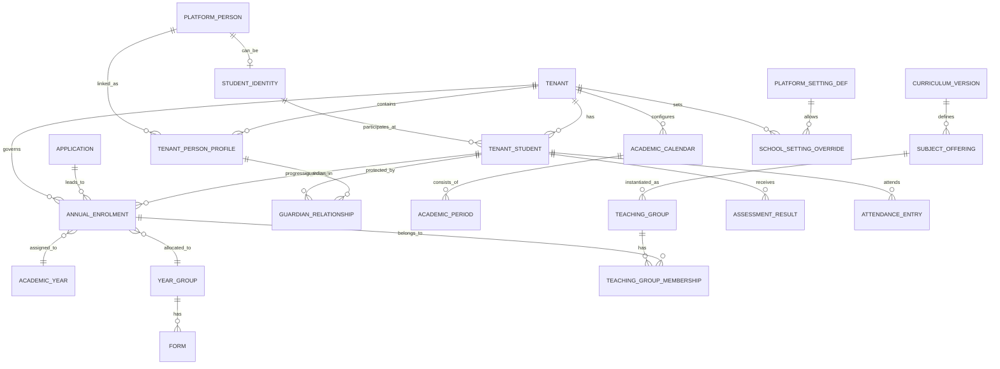

# FOSIS — Conceptual, Logical and Proposed Physical Data Model (Draft v1.0)
**Status:** Logical model and implementation proposal, **not executable production schema**. **Sources:** [legacy logical data model](../architecture/logical-data-model.md), Epics 1–41, global settings issue #249 and [architecture](01-solution-architecture.md). Companion [design](02-domain-design.md), [development plan](04-development-plan.md).

## M1. Data modelling rules
1. Immutable internal UUIDs as physical PKs; globally stable, opaque external FOS ID for authorised cross-system identity mapping, not a person's email, name or school roll number.
2. **Person is not Student, Student is not Enrolment, and Student–Guardian relationship is not authorisation.** Model separate lifecycles.
3. An accepted applicant may have `person_id` and `enrolment_id` without a permanent `student_id` until authorised joining/arrival, as issue #82 directs. **Conflict gate ADR-006** with Epic 1 #33; do not implement Student-ID issuing until resolved.
4. Global identity service owns platform Person/Student identity; tenant-scoped profiles, enrolments, guardian relationships and privileges reside in tenant-owned records. Platform-wide identity does **not** expose other-school relationships.
5. All school-scoped rows use `tenant_id` and tenant-qualified FKs/unique indexes, or an equally verified isolation design after ADR-004. Enrolment is annual; withdrawal closes it; rejoining creates a new row.
6. Raw assessment evidence/marks remain separate from derived grades and publicly released report values. Effective-dated and versioned statuses protect history.
7. Classification, legal purpose, records retention, audit/provenance, actor and origin are recorded, especially for health, safeguarding and personal data.
8. API/OneRoster IDs are outward projections. The existing Ed-Fi ODS → OneRoster view hash `sourcedId` is **not** the native FOSIS primary key.
9. App-wide metadata, tenant defaults and mandatory platform locks are separate from per-school override values.
10. Strict contract/schema migrations with additive rollout, reindex and backfill preview; no destructive migrations without approved retention/rollback plan.

## M2. Main entity relationship view

Mermaid is illustrative; actual SQL requires tenant-qualified keys and more junctions. Applicant prejoin enrolment cannot require `student_id`.

## M3. Schema ownership catalogue: Epics 1–41 + platform
| Owner | Canonical entities (planned; not all detailed stories complete) |
|---|---|
| Global identity / 1 | PlatformPerson, StudentIdentity, StudentIdentifier, IdentityResolutionCase, MergeCase, IdentityAlias, StudentNameVersion |
| Guardian / 2 | TenantPersonProfile, Household, HouseholdMember, GuardianRelationship, ParentalResponsibility, ContactPriority, CollectionAuthorisation, EmergencyContact |
| Admissions / 3 | Applicant, Application, ApplicationEvidence, AdmissionStage, Offer, OfferAcceptance, Waitlist, AdmissionsDecision |
| Academic / 4 | School, Campus, Division, AcademicCalendar, AcademicPeriod, AcademicYear, YearGroup, Form, FormPlacement, House, HolidaySource |
| Enrolment / 5 | AnnualEnrolment, EnrolmentPrerequisite, EnrolmentApproval, JoinConfirmation, Placement, Withdrawal, Completion, RolloverDecision |
| Curriculum / 6 | Curriculum, CurriculumVersion, Stage, Subject, SubjectOffering, LearningObjective, TeachingGroup, TeachingMembership, TeacherAssignment, TeachingTimeRequirement |
| Options / 7 | OptionWindow, EligibleChoice, RankedPreference, OptionBlock, Capacity, SelectionAllocation, OptionWaitlist, SelectionApproval |
| Timetable / 8 | BellSchedule, TimetableVersion, TimetableSlot, LessonAssignment, Clash, HODApproval, PublicationSchedule, TemporaryOverlay, CoverAssignment |
| Attendance / 9 | RegisterExpectation, AttendanceRegister, AttendanceEntry, AttendanceCorrection, RegisterSubmission, AbsenceCase |
| Leave / 10 | LeaveRequest, LeavePeriod, LeaveEvidence, LeaveDecision, AuthorisedAbsencePeriod, LeaveWorkflowLink |
| Assessment / 11 | AssessmentTemplate, Component, Cycle, Rubric, ObjectiveMapping, ObjectiveAttainmentEvidence, Recommendation, ModerationCase |
| Gradebook / 12 | AssessmentResult, ResultVersion, MarkEntryBatch, GradeScheme, CalculatedGrade, GradeApproval, ReleaseSchedule |
| Reports / 13 | StudentReport, ReportTemplate, ReportSection, ReportReview, ReportPublication, Acknowledgement |
| Behaviour / 14 | BehaviourEvent, MeritAward, HousePointEntry, PastoralCase, Intervention |
| Safeguarding / 15 | SafeguardingConcern, ChronologyEvent, Referral, SafeguardingAccessGrant, SafeguardingEvidence |
| Learning Support / 16 | SupportNeed, SupportPlan, Accommodation, SupportReview, InterventionAssignment |
| Health / 17 | MedicalDeclaration, Allergy, MedicationOrder, AdministrationEvent, OperationalHealthAlert, ClinicVisit, ParentNotification |
| Documents / 18 | DocumentRecord, DocumentVersion, DocumentRequirement, Verification, ExpiryWatch, SecureExport |
| Staff / 19 | Worker, EmploymentReference, WorkerEngagement, Responsibility, Availability, CoverEligibility |
| Rooms / 20 | Site, Building, Room, Facility, Resource, RoomBooking, ResourceReservation, ResourceConstraint |
| Comms / 21 | NotificationRule, CommunicationTemplate, DeliveryAttempt, RecipientResolution, ConsentSnapshot |
| Self-Service / 22 | ParentActionRequest, FormSubmission, ConsentAction, StudentAccessPolicy, Delegation |
| Import / 23 | ImportJob, MappingTemplate, SourceRow, RowValidation, ImportDecision, Reconciliation, RollbackLedger |
| APIs / 24 | IntegrationApplication, OAuthGrant, ApiScope, ExternalEntityMap, WebhookSubscription, WebhookDelivery, APIUsage |
| RBAC / 25 | Account, AuthnBinding, Role, Permission, RoleGrant, ResourceScope, DelegatedGrant, StepUpChallenge |
| Governance / 26 | AuditEvent, AccessAudit, ConsentRecord, RetentionPolicy, LegalHold, DSARCase, DisposalReceipt |
| Analytics / 27 | ReportingDataset, ReportDefinition, ScheduledExport, RegulatorySubmission, AnalyticsProjection |
| AI / 28 | AIProposal, ModelInvocation, HumanDisposition, AIEvaluation, FeaturePolicy |
| Privacy / 29 | AIPrivacyPolicy, RedactionProfile, TokenVaultReference, ModelRoute, GatewayAudit |
| Workflow / 30 | WorkflowDefinition, WorkflowVersion, Instance, Task, ApprovalDecision, SLAClock, Escalation |
| School settings / 31 | SchoolSettingOverride, SettingImpactCheck, SchoolSettingChangeHistory, TenantOnboarding, TenantStatus |
| Reliability / 32 | SLODefinition, OperationalAlert, Incident, CapacityObservation, RecoveryRun |
| Marketplace / 33 | Vendor, ExtensionVersion, Offering, Approval, TenantEntitlement, ScopeConsent, VendorLedger |
| Finance / 34 | FeePlan, FeePeriod, StudentFeeAssessment, InvoiceReference, Adjustment, Concession, PaymentReconciliation |
| On-site / 35 | OnSiteService, ServiceEntitlement, ServiceOrder, MealPreference, SupplierLink |
| Transport / 36 | TransportProvider, ProviderStudentLink, ReceivedEntitlement, ReceivedStatus, IngestReceipt |
| Trips / 37 | OffsiteActivity, Participant, TripConsent, TripStaffAssignment, TripIncident, RiskAcknowledgement |
| Resources / 38 | LearningMaterial, MaterialAssignment, PhysicalCopy, IssueReturn, DigitalAssetReference |
| Portfolio / 39 | PortfolioItem, AchievementEvidence, VerificationDecision, Badge, Revocation, PublicVerificationToken |
| Library / 40 | LibraryProvider, LibraryIdentityMap, LibraryStatusSnapshot, SynchronisationReceipt |
| CPD / 41 | TrainingRequirement, StaffTraining, Certification, CPDEvidence, Verification, RenewalReminder |
| Platform settings / #249 | PlatformSettingDefinition, PlatformSettingVersion, ApprovedModel, SettingLock, PlatformRelease |
| Shared plumbing | EventOutbox, EventInbox, IdempotencyRecord, AttachmentReference, JobExecution, DataClassification, CorrelationReference |

Record inventory covers conceptual entities, **not approval to create every table immediately**; detailed columns, keys and lifecycle requirements for later epics remain subject to elicitation.

## M4. Canonical identity and join design
- `PlatformPerson` — UUID technical PK; opaque FOS Person ID; protected legal identity attributes; no automatic user account. A parent/guardian is a relationship/role of Person, not a different global human.
- `StudentIdentity` — separate identity/identifier created at *approved timing*; unique FOS student ID never reused. Student identity may be linked to a PlatformPerson.
- `TenantPersonProfile` — tenant-specific contact, display names, verification and access metadata; external school cannot enumerate global person relationships.
- `TenantStudent` — scoped existence of an arrived Student in school/tenant; derived status and current placement from annual enrolment.
- `Applicant/Application` — admissions-local prejoin record linked to one or more authorised people; may proceed without StudentIdentity.
- `AnnualEnrolment` — tenant and academic year; unique prejoin enrolment ID, optional student link pre-activation; effective dates, state, provenance; never overwrite historical annual enrolment.
- `GuardianRelationship` — composite tenant/student/guardian reference, type separate from responsibilities, verified/denied scopes, validity, provenance. At least one guardian for the agreed student-identification pathway; no auto-grant solely by relationship type.
- `IdentityAlias` and `MergeCase` — reversible 30-day pending retirement for merged duplicate FOS ID (#41), preserves references and audit.

**Open blocking contradiction:** #33 appears to generate Student identity early; #82 explicitly defers Student ID until physical arrival. The physical model deliberately allows null prejoining link. Domain workflow cannot be coded until product owner adjudicates.

## M5. Draft physical conventions (pending ADR-002/004)
### M5.1 Schemas
`identity_global` (platform-only; no direct school principals); `tenancy` (school tenants, scoped profiles); `academic`; `learning`; `operations`; `care` (restricted); `security`; `governance`; `integration`; `platform`. Schema names are proposed; schema does not by itself ensure access boundaries. Sensitive care tables may require a physically segregated deployment after threat modelling.

### M5.2 Key and index conventions
- `id uuid` immutable surrogate PK; `tenant_id uuid NOT NULL` for tenant records; `created_at`/`updated_at` UTC timezone-aware and `created_by` for authoritative writes; `version bigint NOT NULL` optimistic concurrency.
- Tenant row with scoped FK uses `UNIQUE (tenant_id,id)` and `FOREIGN KEY (tenant_id,<ref_id>) REFERENCES ... (tenant_id,id)`. No tenant FK to a global table exposed to direct school-authenticated SQL.
- Partial unique indexes for one active entitlement/assignment only where business overlap semantics explicitly agreed; prefer exclusion constraints for non-overlapping ranges when approved.
- Global IDs and external IDs encrypted/tokenised as needed; indexes use scoped hashes for protected identifiers where plaintext equality search would expose PII. Immutable alias/canonical mapping for merge.
- No `ON DELETE CASCADE` on canonical students, enrolment, governance, sensitive records or published results. Retention disposition uses policy-governed process.
- RLS must enforce the *resolved* tenant and actor scope; policies protecting only tenant_id are necessary but insufficient. PostgreSQL owner, superuser and BYPASSRLS bypasses are prohibited in application accounts.

### M5.3 Illustrative SQL skeleton (design sketch, NOT migration-ready)
```sql
CREATE EXTENSION IF NOT EXISTS pgcrypto;

CREATE TABLE tenancy.tenant (
  id uuid PRIMARY KEY DEFAULT gen_random_uuid(),
  display_name text NOT NULL,
  jurisdiction text NOT NULL,
  timezone text NOT NULL,
  status text NOT NULL,
  created_at timestamptz NOT NULL DEFAULT now()
);

CREATE TABLE identity_global.person (
  id uuid PRIMARY KEY DEFAULT gen_random_uuid(),
  fos_person_id text NOT NULL UNIQUE,
  created_at timestamptz NOT NULL DEFAULT now()
);

CREATE TABLE identity_global.student_identity (
  id uuid PRIMARY KEY DEFAULT gen_random_uuid(),
  person_id uuid NOT NULL REFERENCES identity_global.person(id),
  fos_student_id text NOT NULL UNIQUE,
  issued_at timestamptz NOT NULL DEFAULT now()
);

CREATE TABLE tenancy.person_profile (
  id uuid PRIMARY KEY DEFAULT gen_random_uuid(),
  tenant_id uuid NOT NULL REFERENCES tenancy.tenant(id),
  person_id uuid NOT NULL REFERENCES identity_global.person(id),
  display_name text,
  verified_at timestamptz,
  UNIQUE (tenant_id, id),
  UNIQUE (tenant_id, person_id)
);

CREATE TABLE tenancy.tenant_student (
  id uuid PRIMARY KEY DEFAULT gen_random_uuid(),
  tenant_id uuid NOT NULL REFERENCES tenancy.tenant(id),
  student_identity_id uuid NOT NULL REFERENCES identity_global.student_identity(id),
  created_at timestamptz NOT NULL DEFAULT now(),
  UNIQUE (tenant_id, id),
  UNIQUE (tenant_id, student_identity_id)
);

CREATE TABLE academic.academic_year (
  id uuid PRIMARY KEY DEFAULT gen_random_uuid(),
  tenant_id uuid NOT NULL REFERENCES tenancy.tenant(id),
  name text NOT NULL,
  starts_on date NOT NULL,
  ends_on date NOT NULL,
  CHECK (starts_on <= ends_on),
  UNIQUE (tenant_id, id)
);

CREATE TABLE academic.annual_enrolment (
  id uuid PRIMARY KEY DEFAULT gen_random_uuid(),
  tenant_id uuid NOT NULL REFERENCES tenancy.tenant(id),
  application_id uuid, -- tenant-qualified FK added with Admissions schema
  tenant_student_id uuid, -- NULL until approved Student creation/arrival
  academic_year_id uuid NOT NULL,
  status text NOT NULL,
  effective_from date,
  effective_to date,
  version bigint NOT NULL DEFAULT 1,
  created_at timestamptz NOT NULL DEFAULT now(),
  UNIQUE (tenant_id, id),
  FOREIGN KEY (tenant_id, academic_year_id)
    REFERENCES academic.academic_year(tenant_id, id),
  FOREIGN KEY (tenant_id, tenant_student_id)
    REFERENCES tenancy.tenant_student(tenant_id, id)
);

CREATE TABLE tenancy.guardian_relationship (
  id uuid PRIMARY KEY DEFAULT gen_random_uuid(),
  tenant_id uuid NOT NULL REFERENCES tenancy.tenant(id),
  tenant_student_id uuid NOT NULL,
  guardian_person_profile_id uuid NOT NULL,
  relationship_type text NOT NULL,
  responsibility_status text NOT NULL,
  valid_from date NOT NULL,
  valid_to date,
  CHECK (valid_to IS NULL OR valid_to >= valid_from),
  UNIQUE (tenant_id, id),
  FOREIGN KEY (tenant_id, tenant_student_id)
    REFERENCES tenancy.tenant_student(tenant_id, id),
  FOREIGN KEY (tenant_id, guardian_person_profile_id)
    REFERENCES tenancy.person_profile(tenant_id, id)
);
```
This skeleton omits actual field classification, RBAC grants, RLS policies, retention rules, admissions foreign key, chronology, and authoritative state transition triggers **intentionally**. No team should deploy it without the gate below.

### M5.4 RLS enforcement pattern (candidate only)
For each tenant table: `ENABLE ROW LEVEL SECURITY` plus `FORCE ROW LEVEL SECURITY`; isolate row by authenticated transaction-scoped tenant context and permitted actor scope; deny if context absent; application role must not own tables or have `BYPASSRLS`. Use `SET LOCAL` inside a transaction only from validated server credentials, never from an untrusted request header. Complement RLS with server record/field checks for guardian, medical and safeguarding access. Test malicious tenant IDs, missing claims, transaction pooling and cross-tenant joins.

## M6. Core lifecycle state models
| Aggregate | Authoritative example states | Design invariants |
|---|---|---|
| AnnualEnrolment | Pending; Confirmed/AwaitingJoining; Active; WithdrawnBeforeJoining; Withdrawn; Completed | Enrolment ID exists prejoin; arrival activation under authority; one academic history row per lifecycle; rejoin creates fresh row |
| AttendanceRegister | Expected; Draft; Submitted; Corrected | NotMarked is not Absent; no holidays/noneligible dates; submitted audit immutable, amendment recorded |
| LeaveRequest | Draft; Submitted; NeedsEvidence; Approved; NotApproved; Cancelled | A human approves; time-window eligibility and evidence reviewed; separate factual absence outcome |
| TimetableVersion | Draft; PendingHOD; PendingFinal; Approved; Published; Superseded | Draft clashes allowed; final hard clash blocked; publish audience effective dates |
| AssessmentResult | Draft; TeacherApproved; PendingReview; Approved; Released; AmendedVersion | Never expose draft to parent/student; raw mark retained; approved version not silently overwritten |
| SettingVersion | Proposed; Published; Superseded; Locked | School cannot override hard lock; effective-date history/impact |
| IdentityMergeCase | Requested; ConflictReview; PendingRetirement; Reversed; Retired | 30-day reversal window per #41; never reuse retired FOS ID |

These are **representative state vocabulary proposals**. Exact transition/exception matrices must be reconciled with every owning issue before coding.

## M7. Sensitive datasets and storage
- Student demographic identifiers, official documents: restricted PII, tenant + field-level rules, encryption and purpose restrictions.
- Detailed medical and safeguarding: high-sensitivity partition/row/field controls, read audit, special staff privileges, signed document access; break-glass with reason and limited life.
- Operational allergy/emergency alert: *minimal safe derivative* exposed to eligible staff by need-to-know rather than full health records.
- API/webhook payloads: no free-form sensitive data by default; external ID maps belong to specific integration and tenant.
- FoS parent app: agreed minimum student **first name** retained in FoS; FOSIS authoritative full identity stays within FOSIS, permitted views computed per child relationship and explicit release state.
- AI prompts/responses: use context/token map under privacy gateway, encrypted references and masked audit; no external provider sees unrestricted global Person or safeguarding tables.

## M8. Data integrity, reconciliation and lineage
- Domain-event outbox same DB transaction as authoritative change; inbox keyed by `consumer_id,event_id`; idempotency record per actor/tenant/operation key; retries visible.
- External system map: `tenant_id + integration_id + entity_type + external_id` → stable internal ID and sync metadata; no assumption external ID globally unique.
- `source_system, source_record_id, acquired_at, verified_by, source_version` on migrated or claimed authoritative data; conflicted values route review, not silent overwrite.
- Schema changes use expand → backfill (reconciled) → switch readers → contract (approved) with monitoring and rollback plans.
- Backups, restore, per-tenant export, DSAR and legal hold operate over full related graph, not a single Student row.
- Time: store UTC for instants, IANA timezone for school, local `date` where school-day semantics require it; effective ranges on memberships and approvals.

## M9. Indexing and operational query patterns
Candidate indexes: `(tenant_id, status, updated_at)` for work queues; `(tenant_id, academic_year_id, status)` enrolments; `(tenant_id, student_identity_id)` student lookup bridge; `(tenant_id, starts_at)` calendar/session; `(tenant_id, teaching_group_id, valid_from)` membership; `(tenant_id, register_id, student_id)` attendance; `(tenant_id, assessment_id, student_id)` results; `(tenant_id, aggregate_type, aggregate_id, occurred_at)` audit; event outbox `(delivery_status, next_attempt_at)`. Final index/cardinality choices require representative load and query plans. Partition or archive only with verified retention/restore/uniqueness behaviour.

## M10. Migrations and implementation gate
Start with IDs/tenant/global Person profile/guardian linkage, school/calendar, generic authz/config/audit/outbox. Add Admissions/Enrolment tables after ADR-006. Avoid creating unreviewed tables for Epics 7–41 prematurely. Before every migration: data-owner approval, FK tenant-safety proof, rollback or expand/contract plan, data classification, retention, policies, test fixture, access-denial and concurrency tests, performance benchmark. Cross-reference [solution architecture A10](01-solution-architecture.md) and [domain design D7](02-domain-design.md).

## M11. Outstanding model decisions
1. **Identity timing** conflict (#33 versus #82/#83) and global identity disclosure rules.
2. Actual database/dialect and whether Ed-Fi ODS is an upstream school provider vs the SIS canonical store.
3. Consent/retention/jurisdiction by record class and cross-region tenancy location.
4. Admission/Application child and prejoin guardian-link staging (must not prematurely mint Student ID).
5. Historical curriculum version transitions, concurrent enrolment/cross-school moves and privacy of reused person identity.
6. One common marks/approval model for Epic 11 US 11.5 and Epic 12 and authoritative evidence adjustments.
7. Exact permissions for specialist health/safeguarding domains, and audit redaction/retention for those records.
8. Domain-specific uniqueness, status transitions, index cardinality and cohort/year capacity thresholds awaiting detailed stories.
